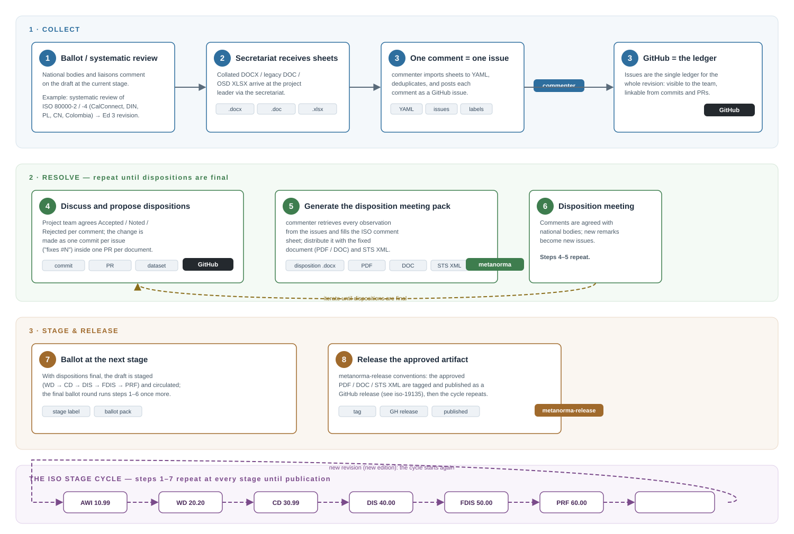

== The lifecycle, in eight steps

This cycle is not folklore — it is the procedure defined by the
https://www.iso.org/sites/directives/current/consolidated/index.html[ISO/IEC
Directives, Part 1: _Procedures for the technical work_] (Clause 2, "Project
management"), shared by ISO, IEC, and ISO/IEC joint committees. The Directives
define the seven development stages with their official stage codes (00
Preliminary/PWI, 10 Proposal/NP, 20 Preparatory/AWI and WD, 30 Committee/CD,
40 Enquiry/DIS, 50 Approval/FDIS, 60 Publication/IS), the ballots at each
stage, and the people involved: the *project leader* runs the project team,
the *secretariat* collates and circulates, and — the sentence our whole
workflow implements — after each ballot the *project editor records the
disposition on which consensus is achieved, for every comment received*.

Every ISO document follows the same development cycle, whichever stage it is
at. We have been running it end to end in Git for the current revisions of
ISO 80000-2 (_Mathematics_) and ISO 80000-4 (_Mechanics_), and it is worth
writing the whole thing down in one place:

. *A ballot or systematic review is held* and collects comments from national
  bodies and liaison organizations.
. *The secretariat and project leader receive those comments* as DOCX or DOC
  files — ISO balloting templates, legacy collations, OSD exports.
. *The project leader posts individual comments into the GitHub issue
  tracker* (for projects that use Metanorma or are in liaison with us): each
  comment becomes exactly one issue, imported and deduplicated with the
  https://github.com/metanorma/commenter[commenter] gem.
. *The project team discusses and proposes dispositions* for every comment,
  linking each one to a commit — one commit per issue, one pull request per
  document.
. *For a meeting or comments disposition*, commenter gathers all
  dispositions from the issues, fills in the comment sheet DOCX, and the
  pack is distributed with the fixed document (PDF, DOC) and the STS XML.
. *Steps 4–5 repeat* until the dispositions are final.
. *Once finalized, a ballot is launched* at the next stage, one last round of
  comment disposition is done, the new stage is set, and the approved
  document is released as an artifact using the metanorma-release
  conventions (see the https://github.com/metanorma/iso-19135[iso-19135]
  releases).
. *Steps 1–7 repeat* at every stage — AWI, WD, CD, DIS, FDIS, PRF — until
  the document is published as an International Standard.

== Why put the ledger in GitHub

The traditional flow keeps the ledger in a spreadsheet that one person edits
and emails around. That works until it doesn't: comment IDs collide between
stages, two people resolve the same comment differently, and nobody can say
which document change answered which comment.

When each comment is a GitHub issue, every one of those problems disappears:

* *The ledger is visible.* The whole team sees the same queue, with labels
  per document, stage, and comment type.
* *Resolution is traceable.* The commit that answers a comment references
  the issue (`fixes #90`), and the issue closes when the pull request
  merges. Comment → commit → rendered page, in one chain.
* *The paperwork is generated, not assembled.* The disposition sheet that
  goes back to the committee is produced by a command, not by hand-copying
  answers into a grid.

== The worked example: ISO 80000-2 and ISO 80000-4

The systematic review of ISO 80000-2:2019 and ISO 80000-4:2019 concluded
that both documents required revision, and the new ISO/TC 12 working group
just finished the first full pass of this lifecycle on the Ed 3 drafts:

* 66 comments from five sources (two collations, national body submissions,
  and a liaison) were imported, deduplicated, and posted as
  https://github.com/metanorma/iso-iec-80000/issues[66 issues] — with
  document-qualified markers so that DIN's `DE-002` against 80000-2 never
  collides with DIN's `DE-002` against 80000-4.
* Each disposition was made as a single commit in the document's pull
  request — 51 commits for 80000-2, 10 for 80000-4 — with the rationale
  posted on the issue.
* The disposition sheets (`disposition-80000-2.docx`,
  `disposition-80000-4.docx`) were generated from the issues with a single
  command each, including status shading and the proposed answer for every
  comment.
* The AWI-stage drafts compiled to PDF, DOC, and STS XML from the same
  source, alongside the published editions, which the build keeps frozen at
  their 2019 content.

Substantive fixes landed along the way that would have been easy to lose in
a spreadsheet: an erroneous digit sequence in the Euler number as published,
a self-referential potential-energy definition in 80000-4, and a dimensional
inconsistency in the normal stress remark reported by Colombia's CTS 002
Metrology Committee.

== What each tool does

[cols="1,2",options="header"]
|===
| Tool
| Role in the lifecycle

| https://github.com/metanorma/commenter[commenter]
| Imports every comment format to validated YAML; posts comments as issues;
  retrieves dispositions from issues; fills the ISO comment sheet DOCX.

| GitHub
| The ledger. Issues are the comments; commits are the dispositions;
  milestones and labels track stages; releases carry the artifacts.

| Metanorma
| Renders the document at every stage, from the same source, in PDF, DOC,
  and STS XML — with the published editions kept frozen while the draft
  evolves.

| metanorma-release
| Tags and publishes the approved artifact as a release when a stage is
  finalized.
|===

== How this relates to ISO's Online Standards Development

This workflow is the path for documents developed outside ISO's
https://www.iso.org/it-tools-for-standards-development.html[Online Standards
Development (OSD)] platform — a joint ISO/IEC online editor where drafts are
authored as structured XML (NISO STS), commented on during NP, CD, DIS and
FDIS ballots, and balloted online, with automatic collation of comments
submitted in the ISO commenting template. Since January 2025, OSD is the
default way of working for new ISO projects and revisions, and committees
continuing Word-based development do so by exemption — which is exactly the
lane this Git-native workflow serves, with Metanorma producing the same STS
XML that OSD is built around.

The two paths are converging: OSD already speaks STS and already understands
structured comments, so we expect STS XML exports from Metanorma and
commenter's YAML dispositions to move into OSD for balloting and comment
resolution without re-keying — the Git ledger keeping its full history, OSD
carrying the formal ballot.

== The repeatable part

Nothing in this workflow is specific to these two documents. The directory
layout, the importer calls, the deduplication rules, the issue conventions,
and the export commands are written up as a runnable walkthrough in the
https://github.com/metanorma/iso-iec-80000/tree/main/comments[comments/
directory of the iso-iec-80000 repository] — the intent is that the next
ballot starts from that template instead of from memory.

We are also distilling the workflow into an agent skill, because a queue of
66 issues labeled by document and type turns out to be something automated
agents can work through very well: each comment is small, independent,
verifiable, and linked to its own acceptance criterion. More on that soon.
