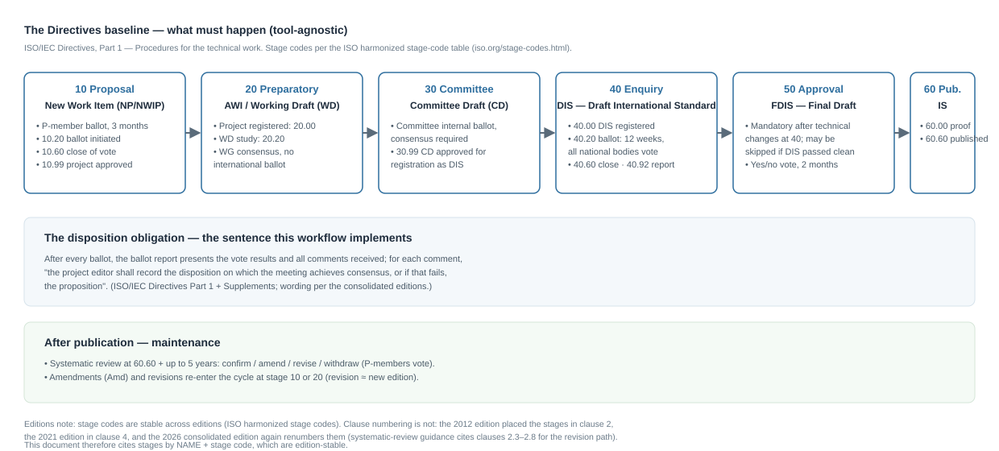
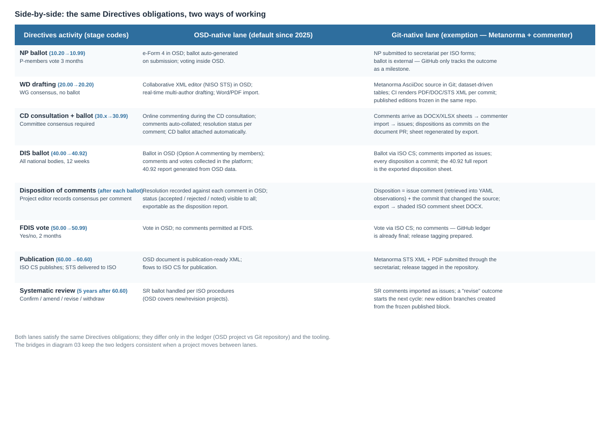
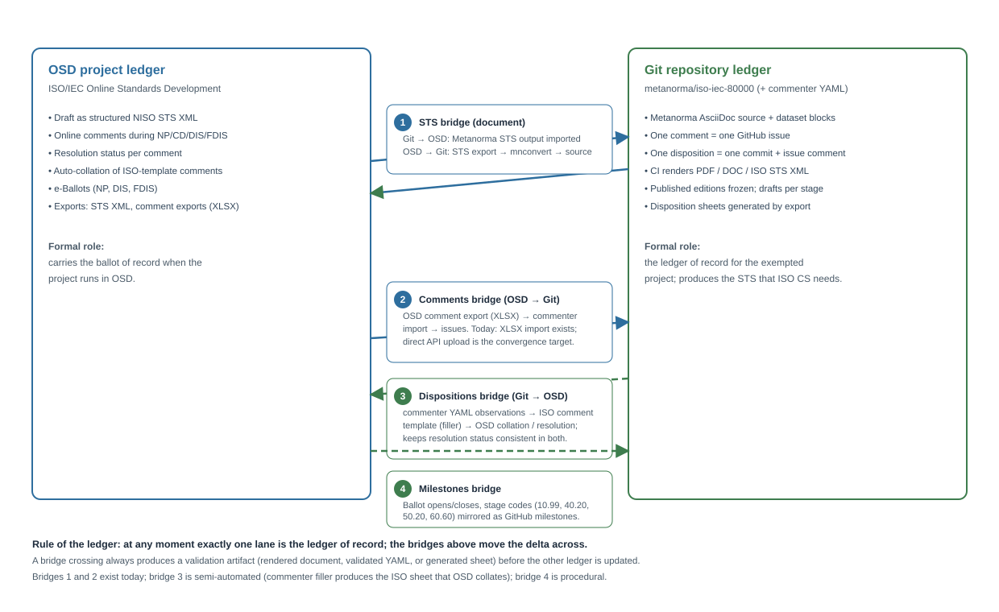
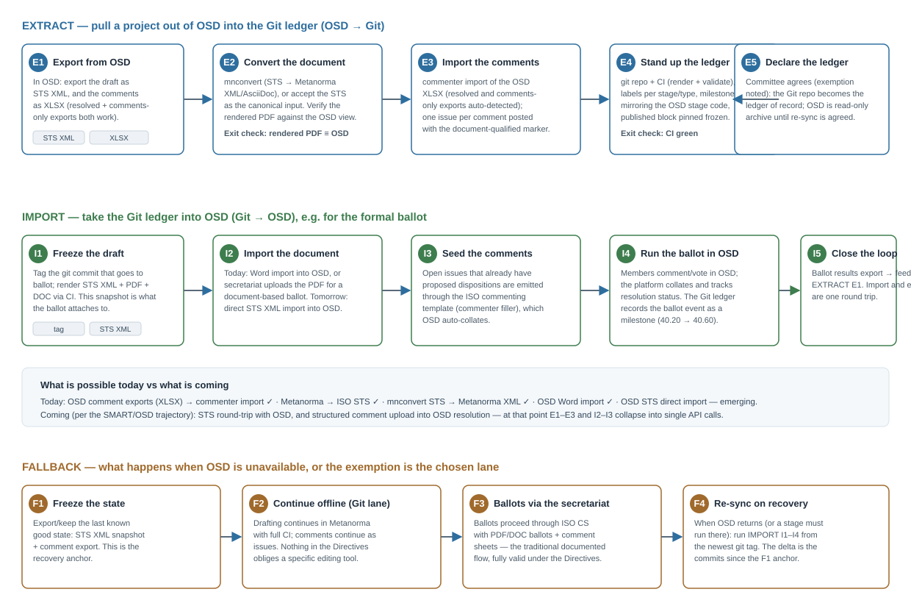
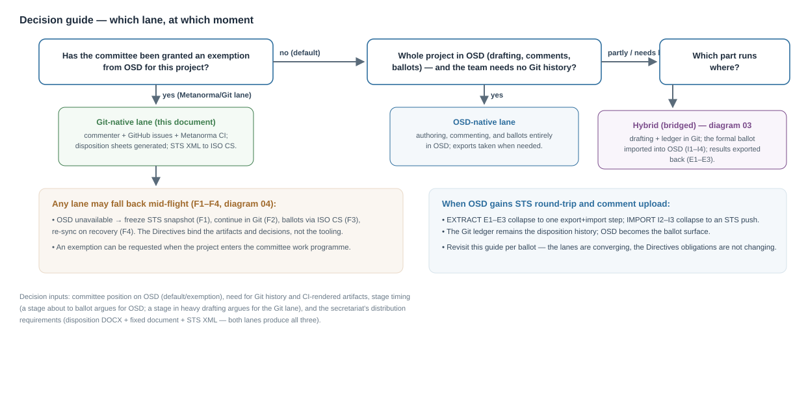

== Managing ISO ballot comments and dispositions with Commenter, GitHub, and Metanorma

This guide describes the complete ISO comment disposition workflow and the two
lanes that implement it: the https://www.iso.org/it-tools-for-standards-development.html[Online
Standards Development (OSD) platform] (the ISO/IEC default) and a Git-native
workflow (Metanorma + the https://github.com/metanorma/commenter[commenter gem] +
GitHub) used by projects that continue outside OSD. It covers how to compare
the lanes, keep them in sync, and move a project between them.

The workflow is proven end to end: it was used to process the systematic-review
comments that produced the current ISO 80000-2 and ISO 80000-4 revision drafts
(66 comments from five sources, one issue and one disposition commit per
comment, generated disposition sheets and AWI-stage drafts).

== The Directives baseline

The procedure is defined by the
https://www.iso.org/sites/directives/current/consolidated/index.html[ISO/IEC
Directives, Part 1 — Procedures for the technical work]. The Directives bind
*what* must happen at each stage — ballots, votes, dispositions, time limits,
stage codes — and are deliberately tool-agnostic. That is why both an OSD
project and a Git-based project satisfy them.

[cols="3,2,4",options="header"]
|===
| Directives activity
| Stage codes
| Obligation

| New work item ballot
| 10.20 → 10.99
| NP circulated to P-members, 3-month vote; approval creates the project.

| Drafting
| 20.00 → 20.20
| Project registered; WD prepared by the project team under the project
  leader; consensus inside the WG, no international ballot.

| Committee draft
| 30.x → 30.99
| CD circulated for committee comment/ballot; consensus required; 30.99 =
  CD approved for registration as DIS.

| Enquiry ballot
| 40.00 → 40.60
| DIS circulated to all national bodies; **40.20 = ballot initiated, 12
  weeks**; 40.60 close of voting; 40.92 = full report circulated / DIS
  referred back.

| Approval vote
| 50.00 → 50.99
| FDIS circulated for a yes/no vote (2 months). Mandatory when technical
  changes followed the DIS; may be skipped if the DIS passed without
  substantive comments.

| Publication
| 60.00 → 60.60
| Proof (PRF) → International Standard published.

| Disposition of comments
| after each ballot
| The ballot report presents the vote results and all comments received;
  for every comment, the project editor records the disposition on which
  consensus is achieved (or, failing that, the proposition).

| Systematic review
| 5 years after 60.60
| P-members decide: confirm / amend / revise / withdraw. A "revise" outcome
  re-enters the cycle (a revision ≈ new edition).
|===

*Editions note.* Stage codes are edition-stable; clause numbers are not (the
2012 edition carried the stages in clause 2, the 2021 edition in clause 4,
and the 2026 consolidated edition renumbers them again). Cite stages by
*name + stage code*, and link the
https://www.iso.org/sites/directives/current/consolidated/index.html[consolidated
edition] for the clause text.

== Side-by-side: the same obligations, two lanes

Key contrasts:

* *Ledger.* OSD keeps the ledger inside the platform (draft + comments +
  resolution status + ballots); the Git lane keeps it in the repository
  (issues are comments, commits are dispositions, CI artifacts are the
  document states).
* *Drafting.* OSD drafts in a collaborative NISO-STS XML editor; the Git lane
  drafts in Metanorma AsciiDoc with dataset-driven tables and renders STS
  XML, PDF, and DOC per commit.
* *Comment intake.* OSD collects comments in-platform and auto-collates those
  submitted in the ISO commenting template; the Git lane imports any format
  (DOCX template, OSD XLSX exports, redlines) into one canonical YAML and
  posts one issue per comment.
* *Dispositions.* OSD records resolution status per comment; the Git lane
  records one commit + one issue comment per comment, and generates the
  disposition sheet.

== Keeping the ledgers consistent

Rule of the ledger: *at any moment, exactly one lane is the ledger of
record*. When work crosses lanes, one of four bridges moves the delta:

[cols="1,3,2",options="header"]
|===
| Bridge
| What crosses
| Today's automation

| B1 — STS (document)
| Draft content
| Metanorma emits ISO STS (Git → OSD direction); OSD exports STS and
  https://github.com/metanorma/mnconvert[mnconvert] turns STS into Metanorma
  XML (OSD → Git direction).

| B2 — Comments (OSD → Git)
| New ballot comments
| OSD comment export (XLSX) is auto-detected by `commenter import`; one
  issue per comment.

| B3 — Dispositions (Git → OSD)
| Proposed answers
| `commenter fill`/`export` produce the ISO comment sheet with the
  observations, which OSD collates; direct API upload is the convergence
  target.

| B4 — Milestones (events)
| Ballot opens/closes, stage changes
| Procedural today: mirrored as GitHub milestones carrying the stage code.
|===

Every bridge crossing ends with a *validation artifact* — a rendered
document, a schema-validated YAML, or a generated sheet — before the other
ledger is touched. No bridge is a silent merge.

== Extract, import, fall back

=== Extract: pull a project out of OSD into Git

* *E1 — Export from OSD*: the draft as STS XML; comments as XLSX (both the
  resolved and comments-only OSD exports are supported by commenter).
* *E2 — Convert*: `mnconvert` turns STS into Metanorma XML/AsciiDoc (or the
  STS stays canonical). *Exit check:* the rendered PDF matches the OSD view.
* *E3 — Import comments*: `commenter import` on the OSD XLSX; one issue per
  comment, posted with document-qualified markers.
* *E4 — Stand up the ledger*: repository + CI (render + validate), stage
  labels, milestone for the current stage code, published block pinned
  frozen. *Exit check:* CI green.
* *E5 — Declare*: the committee notes the exemption/transfer; the Git repo
  becomes the ledger of record; OSD stays as the read-only archive until a
  re-sync is agreed.

=== Import: take the Git ledger into OSD (typically for a ballot)

* *I1 — Freeze*: tag the ballot commit; CI renders STS XML + PDF + DOC.
* *I2 — Import the document*: today via Word import or secretariat-uploaded
  PDF; direct STS import into OSD is on the platform trajectory.
* *I3 — Seed the comments*: issues carrying proposed dispositions are emitted
  through the ISO commenting template (`commenter fill`), which OSD
  auto-collates.
* *I4 — Ballot*: members comment/vote in OSD; the Git ledger mirrors the
  ballot window as a milestone (40.20 → 40.60).
* *I5 — Close the loop*: the ballot results export feeds EXTRACT step E1 —
  import and extract are one round trip.

=== Fall back

* *F1 — Freeze*: keep the last known-good state (STS snapshot + comment
  export). This is the recovery anchor.
* *F2 — Continue offline*: drafting proceeds in Metanorma/Git with full CI;
  nothing in the Directives prescribes an editing tool.
* *F3 — Ballots via the secretariat*: PDF/DOC ballots + comment sheets
  through ISO CS — the traditional documented flow, fully valid.
* *F4 — Re-sync*: on recovery, run IMPORT I1–I4 from the newest tag; the
  delta is exactly the commits since the F1 anchor.

== Which lane, when

Inputs to the decision: the committee's OSD position (since January 2025 OSD
is the default for new projects and revisions, with exemptions available);
whether Git history and CI-rendered artifacts are required; stage timing (a
stage about to ballot argues for OSD, a stage in heavy drafting argues for
the Git lane); and the secretariat's distribution needs — disposition sheet,
fixed document, and STS XML, which both lanes produce.

When OSD gains direct STS round-trip and structured comment upload, the
extract and import chains collapse to single steps — the Git ledger remains
the disposition history while OSD becomes the ballot surface.

== References

* link:https://www.iso.org/sites/directives/current/consolidated/index.html[ISO/IEC
  Directives, Part 1 — Procedures for the technical work (consolidated
  current edition)]
* link:https://www.iso.org/stage-codes.html[International harmonized stage
  codes] and
  link:https://www.iso.org/iso/stage_codes.pdf[stage codes PDF]
* link:https://www.iec.ch/system/files/2025-11/consolidated_iso-iec_part-1_iecsupplement_2024.pdf[ISO/IEC
  Directives, Part 1 + IEC Supplement 2024]
* link:https://jtc1info.org/wp-content/uploads/2022/11/Consolidated-JTC-1-Supplement-2022.pdf[JTC 1
  Consolidated Supplement]
* link:https://helpdesk-docs.iso.org/article/784-osd-adoption-by-iso-committes-and-eligible-projects[OSD
  adoption by ISO committees and eligible projects] (default since
  2025-01-01, exemption process)
* link:https://helpdesk-docs.iso.org/article/649-what-is-online-standards-development-osd[What
  is Online Standards Development (OSD)]
* link:https://www.iec.ch/system/files/2023-07/2023_05_11_osd_qna1_syp_0.pdf[IEC OSD
  Q&A (NISO STS output)]
* link:https://github.com/metanorma/commenter[commenter gem] ·
  link:https://github.com/metanorma/mnconvert[mnconvert] ·
  link:https://github.com/metanorma/metanorma[Metanorma]
